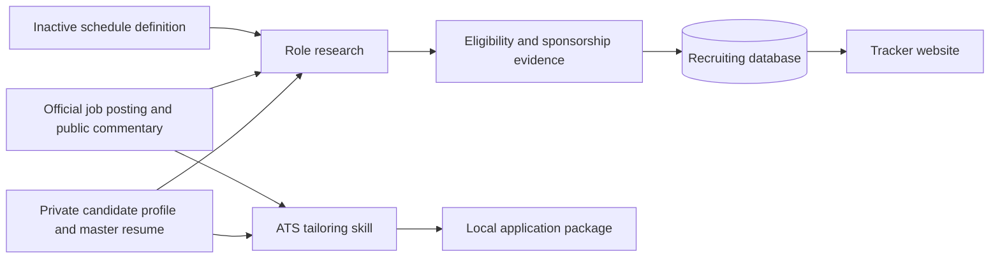

# Previous recruiting project handoff

## Day 1 answer

Reuse the evidence-first job package and status model, then integrate them behind the existing recruiting program's data and UI boundaries. Keep candidate facts in a separate private store. The transferable value is the workflow, schema, prompts, templates, and validation discipline; the original candidate records are deliberately excluded.

## 1. Original goals and architecture

The original local project supported a US new-graduate job search with four linked capabilities:

1. Discover roles and verify eligibility, start date, experience level, and sponsorship evidence.
2. Keep a deduplicated tracker whose state changes only when evidence supports the change.
3. Archive an official job description and public employer commentary, then create a truthful ATS-tailored resume package.
4. Run discovery twice daily through a Codex heartbeat while pausing for authentication, CAPTCHA, unclear work-authorization questions, or other facts that could not be verified.

The architecture was file based: a private candidate profile and master resume fed research and tailoring scripts; Markdown and Excel files held job evidence and status; one folder per company/role held the application package; a local Codex heartbeat invoked the workflow. This import turns the reusable parts into a small application with a relational schema and local web view.



### Known, asserted, assumed

- **Known from local artifacts:** the workflow used an application questionnaire, corrected master resume, Markdown tracker, Excel tracker, PDF builders, a reusable tailoring skill, and a local heartbeat scheduled at midnight and 5:00 AM in `America/Denver`.
- **User asserted:** the workflow was authorized to search and submit suitable applications without per-application review, subject to truthfulness, privacy, authentication, and ambiguity rules.
- **Assumed for this archive:** the existing recruiting program will own identity, authentication, candidate data, and external submission. This repository exposes integration-ready structures and does not recreate private data or browser state.

## 2. Asset map

| Asset | Purpose | Location |
|---|---|---|
| ATS tailoring skill | Archives JD/review evidence and maps verified experience to defensible keywords | `skills/job-application-tailor/` |
| Reusable scripts | Scaffold application packages, validate privacy boundaries, and support tracker operations | `scripts/` |
| Templates | Neutral candidate profile, research notes, keyword map, and schedule inputs | `templates/` |
| Database | Relational schema, versioned migrations, and synthetic seed data | `db/` |
| Website | Local tracker UI backed by sanitized/synthetic data | `web/` |
| Schedule definitions | Inactive task prompt and recreation instructions | `automation/` |
| Feature inventory | Completed, partial, and planned capabilities with evidence | `docs/feature-inventory.md` |
| Exclusion policy | Prevents personal and credential material from entering Git | `.gitignore` and privacy-check scripts |

## 3. Database relationships and integration points

- `companies` has many `jobs`.
- `jobs` has many `research_sources` records, preserving source URL, source class, and retrieval time.
- `jobs` has many `applications`; each application belongs to a generic `candidates` row in synthetic examples only.
- `applications` has many `application_events`, providing an auditable status history.
- Schedule definitions live in versioned YAML outside the database. Checked-in definitions are inactive; an active Codex heartbeat remains external local state.

Recommended integration boundary:

1. Import company, job, evidence, and status structures or map them to the existing program's equivalents.
2. Retain the existing program's user, secrets, authentication, and document storage.
3. Add a private document reference or opaque object key rather than storing resume content in this public repository.
4. Treat external submission as a stateful adapter. Record `submitted` only after observing a confirmation page or API response.

## 4. Install, run, and test

Prerequisites are Python 3.11+, optional SQLite 3, `reportlab` and `openpyxl` from `requirements.txt`, and the Codex desktop application only when recreating a heartbeat.

```powershell
git clone https://github.com/kevinguo0351/Recruiitng_Archive.git
cd Recruiitng_Archive
Copy-Item .env.example .env
python -m venv .venv
.venv\Scripts\python -m pip install -r requirements.txt
.venv\Scripts\python web/app.py --seed
.venv\Scripts\python -m unittest discover -s tests -v
.venv\Scripts\python -m unittest discover -s web/tests -v
```

Open the local URL printed by the development server. All displayed companies, candidates, links, dates, and statuses are synthetic.

```powershell
python -m unittest discover -s tests -v
python -m unittest discover -s web/tests -v
python -m compileall scripts web
```

The sensitive-content check is a defense in depth control and does not replace review of `git diff --cached` before pushing.

## 5. External services and credentials

No credential is required for the synthetic local demo. Optional integrations may use these environment-variable names; values must remain in a local `.env` or secret manager:

- `RECRUITING_DB_PATH`
- `RECRUITING_PRIVATE_DATA_DIR`
- `RECRUITING_STATE_DIR`
- `RECRUITING_OUTPUT_DIR`
- `RECRUITING_HOST`
- `RECRUITING_PORT`
- `APP_PORT`
- `APP_TIMEZONE`

Production adapters may additionally need provider-specific job-board, mail, or OAuth variables. Passwords, one-time codes, CAPTCHA solutions, browser profiles, and password-manager records are never transferable assets.

## 6. Scheduled task definitions versus active schedules

`automation/` contains an **inactive definition** documenting the prompt, timezone, cadence, dependencies, and recreation steps. Committing it does not create or activate a schedule.

The original machine had a separate active Codex heartbeat named `美国求职自动搜岗与投递`, scheduled daily at `00:00` and `05:00` in `America/Denver`. That live schedule is local application state and is not exported. Recreating it requires reviewing the sanitized definition, supplying local private file paths, and explicitly creating a new automation in the destination environment.

## 7. Excluded assets and secure export procedure

The following originals remain local and were not copied:

- Candidate resumes, transcripts, school records, contact details, addresses, phone numbers, emails, work-authorization answers, and immigration dates
- Real application trackers and application history containing candidate-specific decisions
- Customized company resume PDFs and employer submission payloads
- Browser sessions, saved passwords, authentication cookies, OTPs, CAPTCHA state, API tokens, and keychain data
- Private chat history and local Codex thread identifiers
- Excel workbooks or databases containing personal information

Secure export procedure for an authorized destination:

1. Create an encrypted archive outside the Git checkout.
2. Export only the minimum candidate documents required by the destination system.
3. Encrypt with an approved recipient public key or organization-managed encrypted transfer service.
4. Transfer the decryption secret through a separate channel.
5. Verify recipient identity, access scope, retention period, and deletion policy.
6. Import into the destination's private document store and reference it by opaque ID.
7. Delete temporary plaintext exports and verify they were not staged by Git.

## 8. What the next agent should reuse or reconcile

Reuse the evidence records with source type/retrieval time/confidence, application event history, one-folder-per-role package, truthful ATS mapping, schedule-definition separation, synthetic fixtures, and privacy scan.

Before integration:

- Map status labels to the existing program's state machine.
- Decide which program owns company/job deduplication.
- Replace the synthetic candidate adapter with the existing private identity/document service.
- Confirm sponsorship evidence taxonomy and legal-review ownership.
- Choose one scheduler and source of truth for cadence; do not activate duplicates.
- Decide whether PDF generation belongs in the core service or a worker.

## 9. Validation and limitations

Validation evidence is recorded in `docs/feature-inventory.md` and the pull request. Acceptance criteria are clean install, schema migration, synthetic seed load, website smoke test, unit tests, privacy scan, and staged-file review.

Known limits:

- No job-board API or browser submission adapter is included.
- Sponsorship evidence remains probabilistic unless an official source is explicit.
- Resume tailoring cannot validate facts beyond the private candidate source supplied at runtime.
- The website is a local reference UI, not a hardened multi-user service.
- The schedule definition does not activate itself and uses placeholder private paths.

## Recommendation

Integrate the schema and evidence workflow first, then connect the existing recruiting program's private candidate store and submission adapter. This preserves the strongest verified behavior while avoiding duplication of authentication and personal-data handling.
